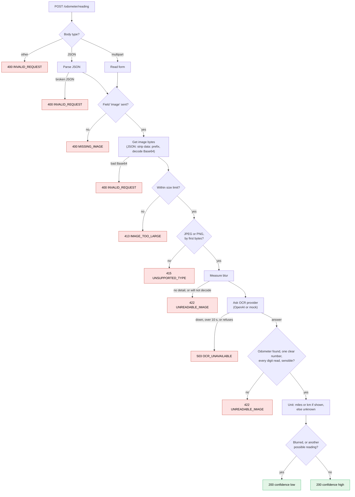

> A photo goes in. The mileage, its unit and a `low` / `high` confidence come out. When the service is not sure, it returns an error, never a guess.
>
> Below the line is the original brief, unchanged. Where it left a point open, the decision is in [`docs/decisions.md`](docs/decisions.md).

## Run

Mock mode is the default. No account, no network.

| | Command |
| --- | --- |
| Docker | `docker compose up` |
| Node 24 | `npm install`, then `npm run dev` |
| Tests | `npm test` |
| Every story, end to end | `scripts/e2e.sh` |
| Live OpenAI | `OCR_PROVIDER=openai OPENAI_API_KEY=sk-... npm run dev` |
| Live AI model on labelled photos | `OPENAI_API_KEY=sk-... npm run harness` |

Settings can also live in `.env`. Copy `.env.example`.

```bash
curl -X POST http://localhost:3000/odometer/reading \
  -F "image=@images/33c24909-e9dd-46d3-8e7f-c44fd9896537.jpeg"
# {"reading":62690.5,"unit":"miles","confidence":"high"}
```

## Design

Decisions, trade-offs and risks live in `docs/`:

- [`domain.md`](docs/domain.md): user stories and constraints
- [`decisions.md`](docs/decisions.md): each decision, the options rejected, the trade-off accepted
- [`plan.md`](docs/plan.md): stack, tests, the PRs and what changed on the way
- [`technical-notes.md`](docs/technical-notes.md): exact values, settings and test evidence

Open risks:

- A wrong number could still come back as `high`. More labelled photos will test this.
- A photo with only the odometer blurred can pass as `high`.
- OpenAI is not yet compared with a second provider.

## How a request flows

The first check that fails decides the response.



---

*Original brief, unchanged:*

# Odometer Reading Service

A TypeScript HTTP service that reads the mileage from a photo of a car odometer.

Upload a JPEG or PNG of an odometer and get back the reading, its unit and a confidence level, or a clear error when the image can't be read.

---

## Features

- Single endpoint: `POST /odometer/reading`
- Accepts images as `multipart/form-data` or as Base64 in a JSON body
- Supports JPEG and PNG
- Structured JSON responses for both successful reads and errors
- Pluggable OCR provider, with a mock mode that needs no credentials
- Written in strict TypeScript and covered by tests

---

## Getting Started

### Prerequisites

- Node.js 20+
- npm

### Install

```bash
npm install
```

### Run

```bash
npm run dev
```

The service starts on `http://localhost:3000`.

### Test

```bash
npm test
```

---

## Configuration

| Variable       | Default | Description                                      |
| -------------- | ------- | ------------------------------------------------ |
| `PORT`         | `3000`  | Port the service listens on                      |
| `OCR_PROVIDER` | `mock`  | OCR backend to use (`mock` or a real provider)   |

In `mock` mode the service runs end to end without any external account. Configure a real provider's credentials through environment variables to use live OCR.

---

## API

### `POST /odometer/reading`

#### Multipart upload

```bash
curl -X POST http://localhost:3000/odometer/reading \
  -F "image=@images/33c24909-e9dd-46d3-8e7f-c44fd9896537.jpeg"
```

#### Base64 JSON

```bash
curl -X POST http://localhost:3000/odometer/reading \
  -H "Content-Type: application/json" \
  -d '{"image": "<base64-encoded-image>"}'
```

#### Success response

```json
{
  "reading": 48253,
  "unit": "miles",
  "confidence": "high"
}
```

#### Error response

```json
{
  "error": "UNREADABLE_IMAGE",
  "message": "Could not extract a mileage reading from the provided image"
}
```

#### Error codes

| Code                 | Status | When                                           |
| -------------------- | ------ | ---------------------------------------------- |
| `MISSING_IMAGE`      | 400    | No image was provided                          |
| `UNSUPPORTED_TYPE`   | 415    | The file is not a JPEG or PNG                  |
| `INVALID_REQUEST`    | 400    | The body is malformed or the Base64 is invalid |
| `UNREADABLE_IMAGE`   | 422    | No mileage reading could be extracted          |

---

## Sample Images

The `images/` folder contains odometer photos you can use to try the service locally.
