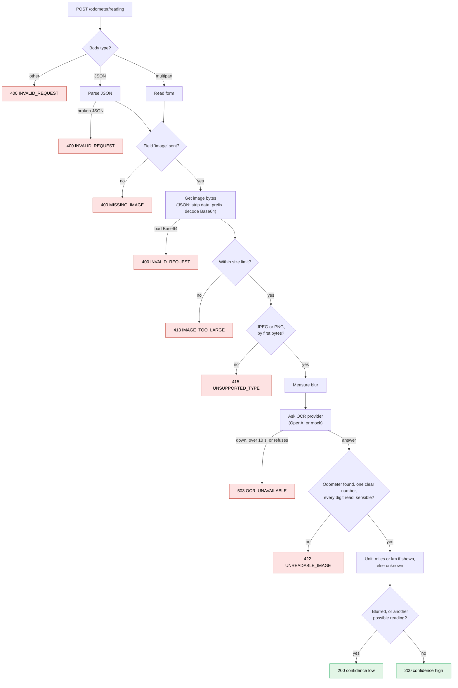

> **About this README.** The sections above the line cover how to run the service and where the design is documented.
> Below the line is the original brief, unchanged. The brief was treated as a draft specification.
> Where it left a point open, a decision was made and recorded with its rationale in [`docs/decisions.md`](docs/decisions.md).

## How to run

Mock mode is the default. It needs no account and no network.

| Way | Command |
| --- | --- |
| Docker, no Node needed | `docker compose up` |
| Node 24 | `npm install`, then `npm run dev` |
| Tests | `npm test` |
| End to end, every story | `scripts/e2e.sh` |

The service listens on `http://localhost:3000`. On start it logs the provider, e.g. `OCR provider: mock, model: fixtures`.

## Check it end to end

One command runs every story case against the real service and prints `ok` or `FAIL` per case.

```bash
scripts/e2e.sh        # add -v to print each response
```

```
nothing on :3000  ->  starts it with docker compose, in mock mode
                  ->  runs 22 checks, S1-S11, 404, and the log line
                  ->  stops it again
already running   ->  uses that service, leaves it running
```

It needs only bash, curl and Docker. It exits non-zero when a check fails. The 503 cases (S12) need a failing provider, so the HTTP tests in `npm test` cover them.

Try a sample photo:

```bash
curl -X POST http://localhost:3000/odometer/reading \
  -F "image=@images/33c24909-e9dd-46d3-8e7f-c44fd9896537.jpeg"
```

Live OCR with OpenAI:

```bash
OCR_PROVIDER=openai OPENAI_API_KEY=sk-... npm run dev
OCR_PROVIDER=openai OPENAI_API_KEY=sk-... docker compose up
```

With `OCR_PROVIDER=openai` and no key, the service does not start. The error names the missing setting.

Check the live AI model on the labelled sample photos. It exits non-zero if any wrong reading comes back as `high`:

```bash
OPENAI_API_KEY=sk-... npm run harness
```

Every setting and its default is listed under *Config* in [`docs/technical-notes.md`](docs/technical-notes.md).

## How a request flows

Each check runs in this order. The first one that fails decides the response.



## Design

Read in this order:

| # | File | Answers |
| --- | --- | --- |
| 1 | [`docs/domain.md`](docs/domain.md) | What must it do? User stories S1-S12 and constraints C1-C5 |
| 2 | [`docs/decisions.md`](docs/decisions.md) | What was chosen, and why? D1-D20, each with alternatives and the trade-off accepted |
| 3 | [`docs/plan.md`](docs/plan.md) | How is it built? Stack, tests, 4 PRs |
| 4 | [`docs/technical-notes.md`](docs/technical-notes.md) | Which exact values? Rules, limits, config, test evidence |

Where the build adds to the brief:

| The brief says | The build does | Decision |
| --- | --- | --- |
| `reading` `48253`, a whole number | May have one decimal: `62690.5` | D8 |
| `unit` `miles` | `miles`, `km` or `unknown` | D9 |
| `confidence` `high` | `low` or `high` | D10 |
| 4 error codes | Also 413 `IMAGE_TOO_LARGE`, 503 `OCR_UNAVAILABLE`, 404 `NOT_FOUND`, 500 `INTERNAL_ERROR` | D5, D13, D19 |
| Node.js 20+ | Node 24 | D3 |
| `PORT`, `OCR_PROVIDER` | Also `OPENAI_API_KEY`, timeout, size limits, blur cut-off | D5, D11, D12, D13 |
| A real OCR provider | OpenAI vision, for now | D12 |
| npm only | Also Docker Compose | D20 |

---

*Original brief, unchanged:*

# Odometer Reading Service

A TypeScript HTTP service that reads the mileage from a photo of a car odometer.

Upload a JPEG or PNG of an odometer and get back the reading, its unit and a confidence level, or a clear error when the image can't be read.

---

## Features

- Single endpoint: `POST /odometer/reading`
- Accepts images as `multipart/form-data` or as Base64 in a JSON body
- Supports JPEG and PNG
- Structured JSON responses for both successful reads and errors
- Pluggable OCR provider, with a mock mode that needs no credentials
- Written in strict TypeScript and covered by tests

---

## Getting Started

### Prerequisites

- Node.js 20+
- npm

### Install

```bash
npm install
```

### Run

```bash
npm run dev
```

The service starts on `http://localhost:3000`.

### Test

```bash
npm test
```

---

## Configuration

| Variable       | Default | Description                                      |
| -------------- | ------- | ------------------------------------------------ |
| `PORT`         | `3000`  | Port the service listens on                      |
| `OCR_PROVIDER` | `mock`  | OCR backend to use (`mock` or a real provider)   |

In `mock` mode the service runs end to end without any external account. Configure a real provider's credentials through environment variables to use live OCR.

---

## API

### `POST /odometer/reading`

#### Multipart upload

```bash
curl -X POST http://localhost:3000/odometer/reading \
  -F "image=@images/33c24909-e9dd-46d3-8e7f-c44fd9896537.jpeg"
```

#### Base64 JSON

```bash
curl -X POST http://localhost:3000/odometer/reading \
  -H "Content-Type: application/json" \
  -d '{"image": "<base64-encoded-image>"}'
```

#### Success response

```json
{
  "reading": 48253,
  "unit": "miles",
  "confidence": "high"
}
```

#### Error response

```json
{
  "error": "UNREADABLE_IMAGE",
  "message": "Could not extract a mileage reading from the provided image"
}
```

#### Error codes

| Code                 | Status | When                                           |
| -------------------- | ------ | ---------------------------------------------- |
| `MISSING_IMAGE`      | 400    | No image was provided                          |
| `UNSUPPORTED_TYPE`   | 415    | The file is not a JPEG or PNG                  |
| `INVALID_REQUEST`    | 400    | The body is malformed or the Base64 is invalid |
| `UNREADABLE_IMAGE`   | 422    | No mileage reading could be extracted          |

---

## Sample Images

The `images/` folder contains odometer photos you can use to try the service locally.
